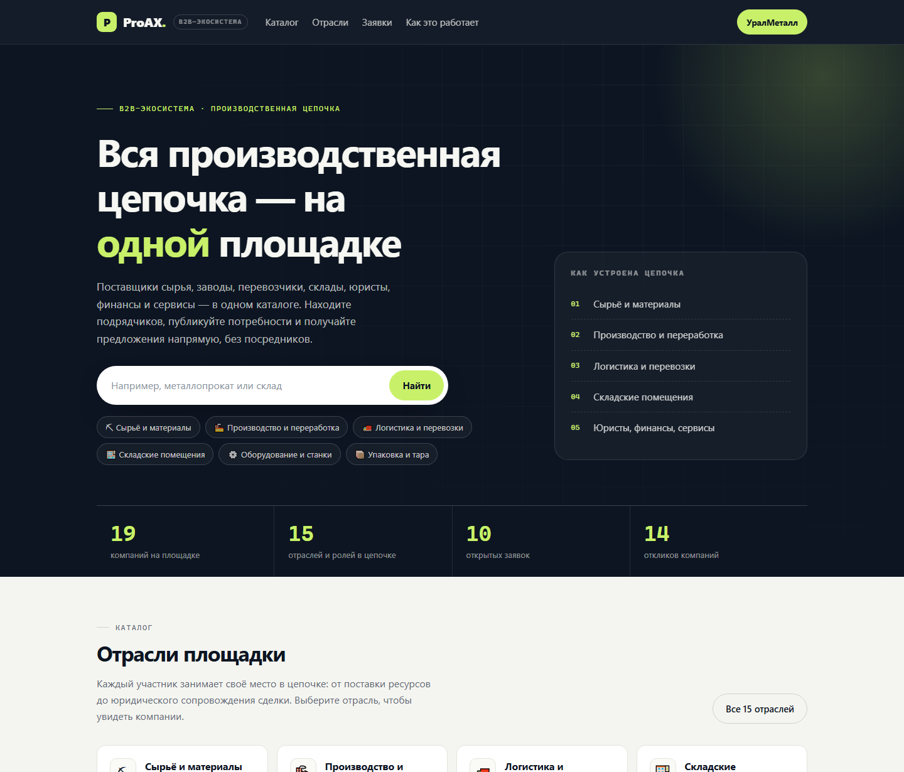
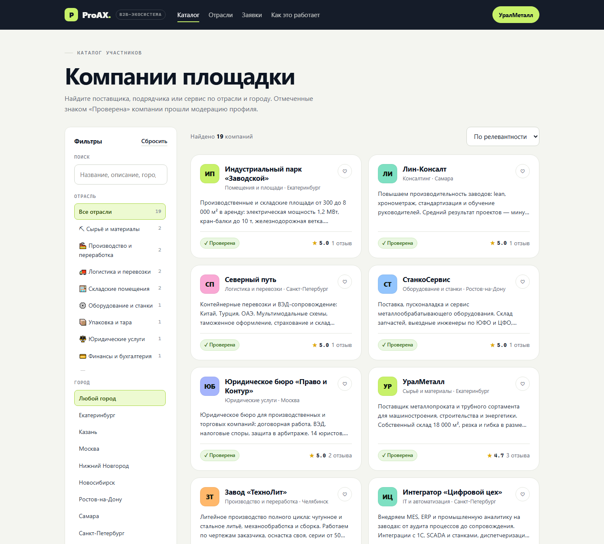
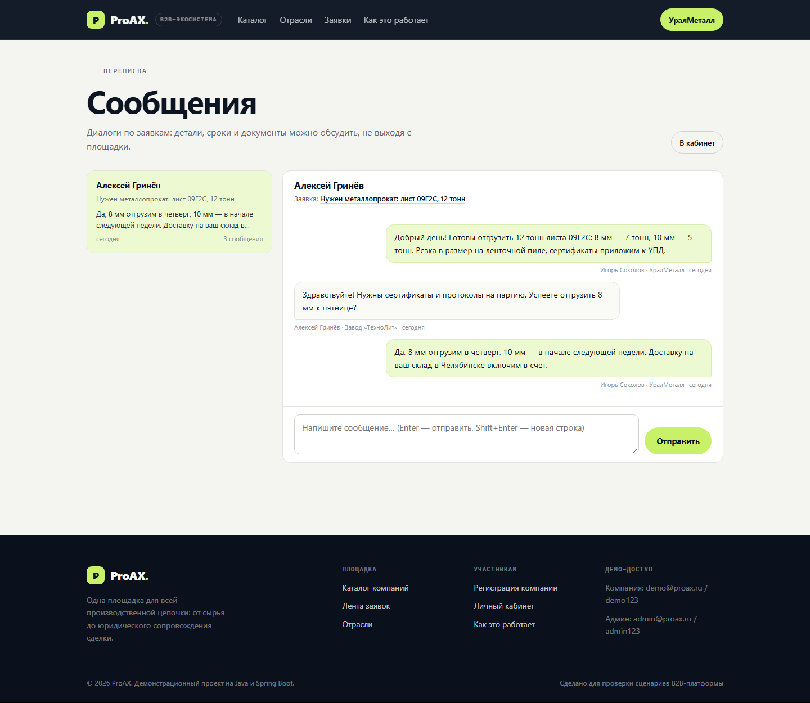
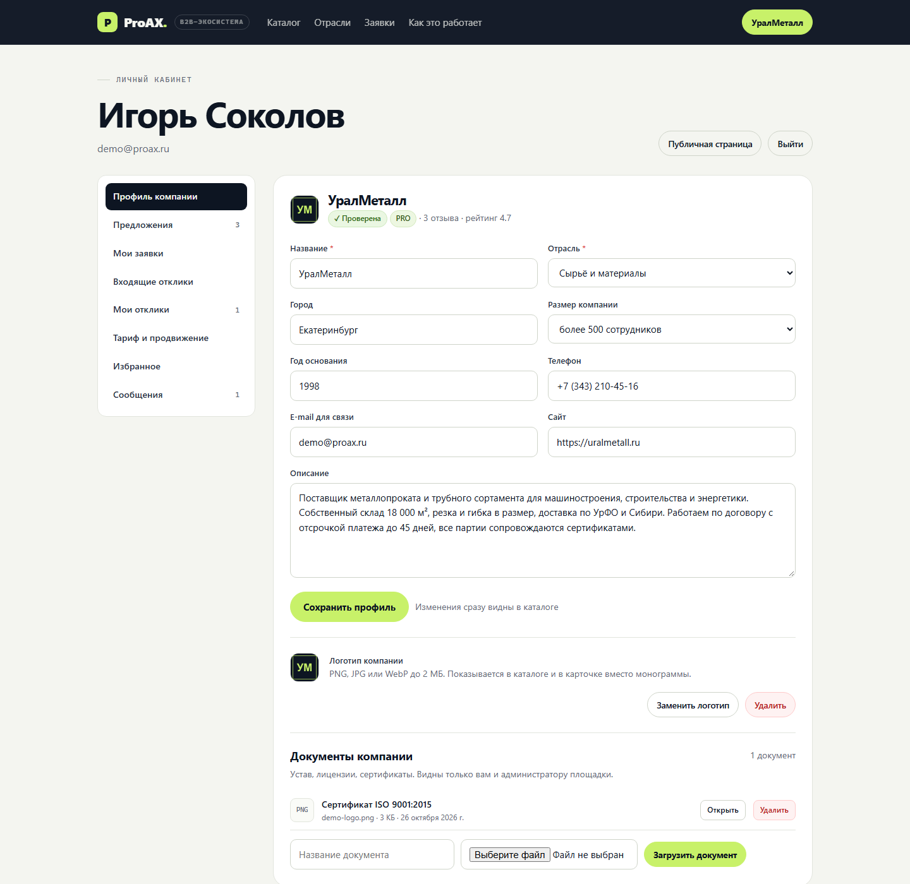

# ProAX — B2B-экосистема на Java и Spring

Одна площадка для всей производственной цепочки: поставщики сырья, производство и переработка,
логистика, складские помещения, оборудование, упаковка, юристы, финансы, IT, маркетинг, персонал
и консалтинг. Компании собираются в общем каталоге, публикуют предложения и потребности,
переписываются по заявкам и начинают сделки без посредников.

Проект — рабочее веб-приложение: сервер на Spring Boot, база на JPA/Hibernate, интерфейс — SPA
без сборщика (vanilla JS, ES-модули) и собственный дизайн.



---

## Что уже работает

**Каталог и профили**

- 15 отраслей-ролей в цепочке (сырьё → производство → логистика → склад → сервисы), счётчики компаний.
- Каталог с поиском по названию/описанию/городу, фильтрами по отрасли и городу, сортировкой,
  пагинацией. Компании с платным тарифом поднимаются в выдаче.
- Карточка компании: логотип, описание, контакты, размер, год основания, товары и услуги, отзывы.
- Отметки «Проверена», «PRO» и «Premium» — результат модерации и оплаченного тарифа.

**Заявки и отклики**

- Лента потребностей с фильтрами по отрасли, статусу и городу.
- Публикация заявки: что нужно, объём, город, бюджет, срок, подробности.
- Отклик компании: предложение и цена; дубли и отклики на собственную заявку запрещены.
- Автор заявки принимает или отклоняет отклики; принятие переводит заявку в статус «В работе».

**Переписка по заявке**

- Отклик автоматически открывает диалог между автором заявки и компанией.
- Отдельная страница «Сообщения»: список диалогов, история, отправка сообщений.
- Сообщения видны только двум сторонам (и администратору), сторонние компании получают 403.
- Диалог привязан к паре «заявка + компания», история сохраняется.

**Тарифы и продвижение**

- Три тарифа: «Базовый» (бесплатно), PRO (4 900 ₽/мес), Premium (14 900 ₽/мес).
- Подключение активирует продвижение на 30 дней: приоритет в каталоге и бейдж в карточке.
- История платежей, сумма оплат, дата окончания; истёкшие тарифы снимаются планировщиком.
- Оплата в демо-версии имитируется (платёжный шлюз не подключён).

**Логотип и документы**

- Загрузка логотипа (PNG/JPG/WebP до 2 МБ) — заменяет монограмму в каталоге и карточке.
- Документы компании (PDF/PNG/JPG до 5 МБ): устав, лицензии, сертификаты; видны только владельцу
  и администратору. Файлы лежат в `./uploads`, раздаются по `/uploads/**`.
- При битом логотипе интерфейс откатывается к инициалам компании.

**Личный кабинет и админка**

- Профиль компании, предложения, мои заявки, входящие и отправленные отклики, избранное.
- Админ-панель: статистика (включая платные компании и диалоги), очередь проверки, верификация.

**Демо-данные**

19 компаний, 15 отраслей, 38 предложений, 12 заявок, 14 откликов, 3 диалога с перепиской,
2 компании на платных тарифах, отзывы.

### Каталог, переписка и кабинет







## Стек

| Слой | Технологии |
|---|---|
| Язык | Java 21 |
| Бэкенд | Spring Boot 3.2.2, Spring MVC, Spring Data JPA, Hibernate 6.4, H2 2.2 (файловая БД) |
| Валидация | Jakarta Bean Validation + Hibernate Validator |
| Аутентификация | серверные сессии (`JSESSIONID`), PBKDF2-HMAC-SHA256, роли `ADMIN` / `COMPANY` |
| Файлы | локальное хранилище `./uploads`, раздача через resource handler Spring MVC |
| Планировщик | `@Scheduled` — снятие истёкших тарифов раз в час |
| Фронтенд | HTML + CSS (своя дизайн-система) + vanilla JS (ES-модули, hash-роутер) |
| Тесты | JUnit 5, AssertJ, MockMvc |
| Сборка | Maven, `spring-boot-maven-plugin` |

Осознанные решения:

- **Без Spring Security и Thymeleaf** — сборка идёт из локального кэша Maven без доступа к сети;
  аутентификация реализована сессионным интерсептором и хешированием паролей на JDK.
  Замена на Spring Security — точечная: `AuthService` + `ApiAccessInterceptor`.
- **Фронтенд без npm** — статические файлы отдаёт сам Spring Boot, сборка не нужна.
- **H2 в файле** — запуск одной командой; профиль `postgres` уже подготовлен.
- **Демо-оплата** — `BillingService` пишет подписку и включает продвижение без платёжного шлюза,
  поэтому тарифный сценарий можно проверить целиком.

## Быстрый старт

Требования: JDK 21 и Maven (или локальный Maven Wrapper в `%USERPROFILE%\.m2\wrapper\dists`).

```powershell
# Windows: сборка и запуск
.\run.cmd

# или по шагам
.\build.ps1            # сборка (офлайн из локального кэша)
.\run.ps1 -Port 8080   # запуск
```

Приложение: <http://127.0.0.1:8080>

Демо-доступ:

| Роль | Логин | Пароль |
|---|---|---|
| Представитель компании «УралМеталл» (тариф PRO) | `demo@proax.ru` | `demo123` |
| Администратор площадки | `admin@proax.ru` | `admin123` |

Обычная сборка с интернетом — без офлайн-режима:

```powershell
mvn clean package
java -jar target\proax.jar
```

База создаётся в `./data/proax.mv.db`, загруженные файлы — в `./uploads`. Демо-данные
заполняются при первом запуске. Чтобы начать с чистого листа — остановите приложение
и удалите папки `data` и `uploads`.

Если после аварийной остановки база открылась в режиме «только для чтения» (H2 держит
блокировку файла), остановите и запустите приложение снова — данные сохранятся, а API
вернёт понятную ошибку `db_read_only`, пока проблема не устранена.

**Смена базы на PostgreSQL**

1. Добавьте зависимость в `pom.xml`:
   ```xml
   <dependency>
       <groupId>org.postgresql</groupId>
       <artifactId>postgresql</artifactId>
       <scope>runtime</scope>
   </dependency>
   ```
2. Создайте базу и пользователя (см. комментарии в `src/main/resources/application-postgres.yml`).
3. Запустите с профилем: `java -jar target\proax.jar --spring.profiles.active=postgres`.

## Структура проекта

```
src/main/java/pro/ax/platform
├── ProAxApplication.java        точка входа (+ @EnableScheduling)
├── config
│   ├── WebConfig.java           интерсептор доступа, SPA-маршруты, раздача /uploads/**
│   ├── SeedData.java            демо-данные площадки
│   └── PlanExpiryJob.java       снятие истёкших тарифов
├── domain                       User, Company, Industry, Offer, NeedRequest, Proposal,
│                                Review, Favorite, ChatThread, ChatMessage,
│                                CompanyDocument, Subscription, Plan + enum-ы
├── repo                         Spring Data репозитории (Specification для поиска)
├── security
│   ├── AuthService.java         вход, сессия, текущий пользователь, роли
│   ├── PasswordHasher.java      PBKDF2-HMAC-SHA256
│   └── ApiAccessInterceptor.java  правила доступа к /api/**
├── service                      Account, Company, Offer, Need, Proposal, Review, Favorite,
│                                Cabinet, Chat, Billing, Document, FileStorage, Admin, Stats
├── support/Slugifier.java       транслитерация названий в URL-slug
├── error/ApiException.java      прикладные ошибки API
└── web                          REST-контроллеры, DTO, единый обработчик ошибок

src/main/resources
├── application.yml              конфигурация (H2, JPA, порт, лимиты загрузки)
├── application-postgres.yml     профиль PostgreSQL
└── static                       фронтенд: index.html, css/styles.css, js/**
```

## REST API (кратко)

| Метод | Путь | Назначение |
|---|---|---|
| POST | `/api/auth/register` | Регистрация представителя + компании |
| POST | `/api/auth/login`, `/api/auth/logout` | Вход / выход |
| GET | `/api/auth/me` | Текущий пользователь (пусто для гостя) |
| GET | `/api/industries`, `/api/cities`, `/api/stats` | Справочники и счётчики |
| GET | `/api/companies?q=&industry=&city=&verified=&sort=&page=&size=` | Поиск компаний |
| GET | `/api/companies/{slug}` | Карточка компании |
| PUT | `/api/companies/{id}` | Редактирование профиля (владелец/админ) |
| GET, POST | `/api/companies/{slug}/reviews` | Отзывы |
| GET, POST | `/api/companies/{id}/offers`, `/api/offers` | Предложения компании |
| PUT, DELETE, PATCH | `/api/offers/{id}`, `/api/offers/{id}/active` | Управление предложением |
| GET | `/api/needs?q=&industry=&status=&city=&page=&size=` | Лента заявок |
| POST | `/api/needs` | Создать заявку |
| GET, PATCH, DELETE | `/api/needs/{id}`, `/api/needs/{id}/status` | Заявка и её статус |
| GET, POST | `/api/needs/{id}/proposals` | Отклики на заявку |
| PATCH | `/api/proposals/{id}` | Принять/отклонить отклик |
| GET | `/api/threads` | Мои диалоги (роль AUTHOR/RESPONDER) |
| GET | `/api/threads/{id}` | Диалог с историей сообщений |
| POST | `/api/threads/{id}/messages` | Отправить сообщение |
| POST | `/api/threads/ensure` | Открыть диалог «заявка + компания» |
| GET, POST | `/api/billing`, `/api/billing/upgrade` | Тариф, история, подключение |
| POST, DELETE | `/api/cabinet/logo` | Загрузить / удалить логотип |
| GET, POST, DELETE | `/api/cabinet/documents`, `/api/cabinet/documents/{id}` | Документы компании |
| GET, POST, DELETE | `/api/favorites`, `/api/favorites/{companyId}` | Избранное |
| GET | `/api/cabinet` | Данные кабинета одним запросом |
| GET, PATCH | `/api/admin/pending-companies`, `/api/admin/companies/{id}/verify` | Модерация |
| GET | `/api/admin/stats`, `/api/admin/needs` | Статистика для админа |

Ошибки приходят в едином формате: `{"code": "...", "message": "...", "fields": {...}}`,
с кодами 400 / 401 / 403 / 404 / 409 / 500.

## Модель данных

- **User** — представитель компании или администратор; пароль хранится как PBKDF2-хеш.
- **Industry** — отрасль/роль в цепочке (15 записей).
- **Company** — карточка участника: отрасль, город, контакты, логотип, рейтинг, тариф, владелец.
- **Offer** — товар или услуга компании с ценой «от» и единицей измерения.
- **NeedRequest** — заявка: отрасль, город, бюджет, срок, статус, автор и его компания.
- **Proposal** — отклик компании на заявку (`NEW / ACCEPTED / REJECTED`).
- **ChatThread / ChatMessage** — диалог по паре «заявка + компания» и его сообщения.
- **Review** — отзыв с оценкой 1–5; уникален в паре «компания + автор».
- **Favorite** — избранная компания пользователя.
- **CompanyDocument** — загруженный документ компании (приватный).
- **Subscription** — запись об оплате тарифа (план, сумма, период).

## Тарифы

| Тариф | Цена | Что даёт |
|---|---|---|
| Базовый | 0 ₽ | Карточка в каталоге, до 3 предложений, отклики на заявки, отзывы |
| PRO | 4 900 ₽/мес | Продвижение в каталоге и поиске, до 20 предложений, документы, бейдж PRO |
| Premium | 14 900 ₽/мес | Первые позиции в каталоге, бейдж Premium, неограниченные предложения |

Продвижение действует 30 дней с момента подключения. `PlanExpiryJob` раз в час снимает истёкшие
тарифы, чтобы каталог не показывал просроченные бейджи.

## Тесты

```powershell
mvn test          # 21 тест
```

- `PasswordHasherTest` — хеширование и проверка паролей.
- `SlugifierTest` — транслитерация названий в slug.
- `MarketplaceApiTest` — регистрация, запрет анонимных изменений, полный цикл
  «заявка → отклик → принятие», правила отзывов, избранное, ограничения админки.
- `ChatBillingApiTest` — переписка (диалог открывается откликом, обе стороны пишут,
  сторонний доступ запрещён), тарифы с продвижением, загрузка логотипа и документов,
  проверка лимитов и типов файлов.

## Ограничения демо-версии

- Платёжный шлюз не подключён: тариф активируется «оплатой в один клик».
- Лимиты тарифов (число предложений и т.п.) описаны в интерфейсе, но не ограничиваются кодом.
- Файлы хранятся на диске сервера, без CDN и антивирусной проверки.
- Нет e-mail/telegram-уведомлений и чата вне заявки.
- Данные демонстрационные, реквизиты и телефоны вымышлены.

## Что дальше

1. Перейти на Spring Security (формы входа, CSRF, «запомнить меня»).
2. Подключить платёжный провайдер (ЮKassa/Stripe) и вебхуки подписок.
3. S3-совместимое хранилище для логотипов и документов, проверка файлов антивирусом.
4. Уведомления о новых сообщениях и откликах (e-mail, Telegram, WebSocket для чата).
5. Аналитика для компаний: просмотры карточки, конверсия откликов, источники трафика.
6. Интеграции с 1С/CRM и экспорт каталога.
